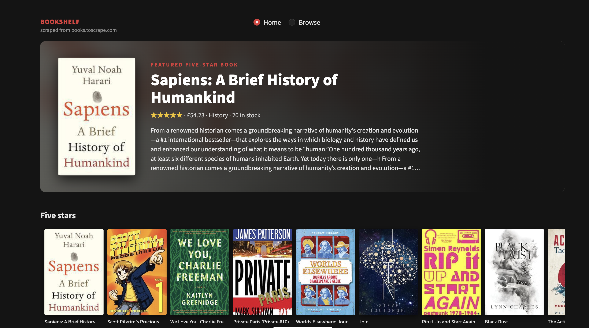

# Books to Scrape

## Purpose
Scrapes book data from https://books.toscrape.com, stores it in a Supabase (Postgres) table, and presents it in a dark-themed Streamlit web app, "Bookshelf" (`app.py`): a featured book and rows of covers on the home page, plus a browse page with filters, a cover grid, a detail view and the full table.

## Data collection
`scraper.py` walks the catalogue list pages with `requests`, opens each book's detail page and parses it with BeautifulSoup (title, category, prices, stock, rating, reviews, description, image, URL). It waits `--delay` seconds (default 0.5) between pages to be polite to the site.

## Data persistence
Records are written to a JSON file (`books.json` is a 10-book sample) and then upserted into the `books` table in Supabase (`schema.sql`). The UPC is the primary key, so re-running the loader updates rows instead of duplicating them. Row level security allows public read only. The loader writes with the service-role key; the app only needs the read-only anon key (`SUPABASE_ANON_KEY`). Both live in `.env`, which is git-ignored.

## User interaction
Collect and store the data from the command line:
```bash
python scraper.py --limit 100 --out books100.json
python load_to_supabase.py --test
python load_to_supabase.py --file books100.json
```
Browse it in the web interface:
```bash
streamlit run app.py
```
The app opens at http://localhost:8501. Start it from this folder, so the dark theme in `.streamlit/config.toml` is used.
- **Home:** a featured five-star book, then rows of covers: five-star books, good value (4+ stars under £25) and one row per category. Click a cover to open the book on books.toscrape.com.
- **Browse:** filters for title, category, minimum rating, price range and stock; the number of matching books with average price and rating; a grid of covers; a detail view with cover, description, UPC, prices and reviews; and, in an expander, the full table and a chart of books per category.

The app reads the `books` table from Supabase when `.env` is set. If Supabase is not configured or not reachable, it falls back to the local `books100.json` (or the committed `books.json` sample) and names the data source at the bottom of the page, so the interface can be tried without a database.

## Setup
Tested with Python 3.13.
```bash
python3 -m venv .venv && source .venv/bin/activate
pip install -r requirements.txt
cp .env.example .env   # fill in SUPABASE_URL, SUPABASE_SERVICE_KEY and (optional) SUPABASE_ANON_KEY
```
Run `schema.sql` in the Supabase SQL Editor (safe to re-run), then the commands above. `streamlit run app.py` also works without `.env`: it then shows the local JSON data.

## Screenshot
The home page of the app, with a featured book and the first row of covers:



## Learning
**Scraping in two steps.** The list pages of books.toscrape.com only show title, price and rating, so the scraper first walks the list pages and then opens each book's detail page for the UPC, stock, category and description. I learned to read the HTML structure (table rows, breadcrumb, CSS classes such as `star-rating Three`) and turn it into clean values with BeautifulSoup and small regular expressions, for example converting "£51.77" into a number. I also added a delay between requests to be polite to the website.

**Choosing a key for the database.** I used the book's UPC as the primary key and `upsert` instead of `insert`. Running the loader twice then updates the same rows instead of creating duplicates, which made it safe to re-run while I was testing.

**Keys and security.** Supabase has a public "anon" key and a secret "service role" key. I learned that the service key bypasses row level security, so it must only live in `.env` (which is git-ignored) and never in the code or the repository. The table allows public read-only access, and the app reads with the read-only key when it is set. The audit before publishing pointed out that the app originally used the service key just to read data, so I changed it.

**Challenge: the database disappeared.** When I came back to the project for submission, the loader failed with "nodename nor servname provided": the Supabase host no longer existed. Free Supabase projects are paused after about a week without use. After restoring it, the server first answered with error 521 while it was starting up, and then "Could not find the table": the project was back, but the database had to be set up again with `schema.sql`. This taught me to read error messages step by step (host not found → server not ready → table missing) and to make `schema.sql` safe to run more than once. It is also why the Streamlit app falls back to the local JSON file when Supabase isn't reachable, so the interface can always be tried.

## Limitations and assistance
**Limitations**
- The scraper only works for books.toscrape.com and depends on its HTML structure.
- Pages are scraped one after another (about 0.5 s per book), so all 1,000 books take roughly 10–15 minutes. There is no automatic re-scraping.
- The app loads the whole table on each refresh, which is fine for the 1,000 books on the site but would not scale to a much larger catalogue.
- Single user, no login. Anyone with the read-only key can view the data, which is intended.

**Assistance**
- The scraper and loader were written with **Claude Code** (Anthropic's AI coding assistant) in October 2026. I ran the scrapes, set up Supabase and checked the data.
- For the submission, Claude Code helped with the Streamlit interface (`app.py`), the README, the fix for loading `.env` from any folder, the re-runnable `schema.sql`, and the audit in `AUDIT.md`.
- The Learning sections in this README were drafted with Claude Code from the full context of our working session and my project history, which my professor allowed. I reviewed them.
- Libraries: requests, BeautifulSoup, supabase-py, Streamlit, pandas. No other tutorials or external code.
